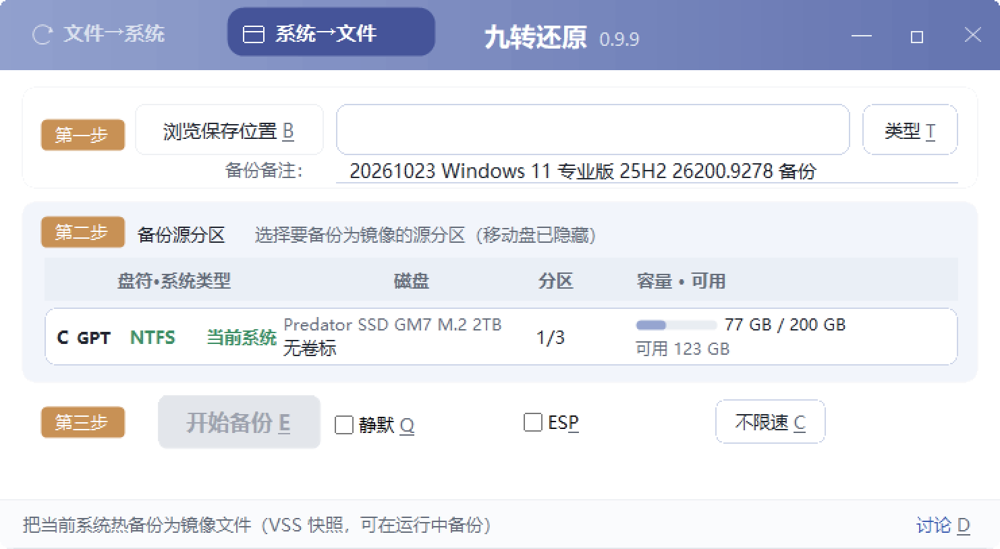

# 九转还原（SysRecover）

> Windows 系统一键备份 / 还原工具  
> **中文** | [English](README.en.md)

[](https://github.com/WooMonlee/SysRecover-Windows-System-Restore-Backup/actions/workflows/ci.yml)
[](https://github.com/WooMonlee/SysRecover-Windows-System-Restore-Backup/releases/latest)

**不到 50MB · 启动比 WinPE 快 · 支持 CA2023 · 可备份 ESP · 可返回安装前的系统 · 可安装启动菜单兜底 · 中英双语 · 完整命令行**




---

## 优点

- 体积不到 **50MB**，启动比多数 WinPE 快
- 支持 **Secure Boot CA2011 / CA2023**，不用关安全启动，也不用注册密钥
- 可把 **ESP 分区**并入同一镜像，还原系统时自动恢复
- 可选保留旧系统，之后**返回安装前的系统**
- 可安装启动菜单，Windows 进不去时用来**兜底启动**
- 中 / 英双语，支持 **完整命令行**
- 支持 **ESD、WIM**，兼顾体积与兼容性

## 缺点

- 只支持 **64 位 CPU**，不再支持 32 位 CPU
- 只支持 **Windows 7 x64 及以后**，不再支持 Windows Vista、2003、XP 及更早版本
- 目前只支持 **ESD / WIM** 格式

---

## 一、已实现

1. **核心使用 wimlib**：Windows 下做热备份和还原，Linux 侧主要做目录交换和修引导；支持 ESD、WIM，以尽可能小的体积实现完整功能。
2. **启动速度比多数 PE 快**：读写盘速度与 PE 相当，支持 **CA2011 / CA2023 双启动链**。
3. **支持全系列命令行参数**，适合批处理、机房和自动化场景。
4. **体积控制到 50MB 以内**，同时保持足够兼容性。
5. **中英双语**。
6. **支持备份 ESP 分区**。
7. **支持安装启动菜单**：
   - BIOS：开机进入 Windows 前连续按上/下键调出选单；
   - UEFI：开机按启动设备快捷键（界面有提示）选择 `SysRecover` 进入还原。
8. **未分区硬盘向导**：新硬盘可以向导式创建 ESP / MSR / 系统分区 / 数据分区。
9. **支持异机还原**：
   - 自带最常用硬件的驱动（约 165MB，位于 `Drivers`）；
   - 无法覆盖所有机型。用户可在自己的电脑上导出驱动，放进 `Drivers` 文件夹，软件会离线注入。

## 二、失去的功能

1. 只支持 **64 位 CPU**，不再支持 32 位 CPU。
2. 只支持 **Windows 7 x64 及以后**；Windows Vista、2003、XP 及更早版本不再支持。早期系统可以寻找网上其他作者的作品。

## 三、为什么还要再写一个

1. 阵列卡 / 服务器机器上，很多 PE 的驱动认不到 RAID 卡。我们的救援层是完整 Linux 内核 + **494 个存储 / 文件系统模块**。
2. 还得准备 U 盘 / PE 启动盘，多一道工序，也多一个出错的地方。我们的救援层内置在软件里，部署一次，之后一条链走到底。
3. Secure Boot 机器上部分同类工具要进 BIOS 关安全启动。我们走微软签名链，用户不用关，也不用注册任何密钥。
4. 很多工具只能手动做还原，真正不能启动时无法为故障兜底。
5. 一部分工具不能通过命令行全自动还原到不同系统。
6. 绝大多数工具在还原后无法返回安装前的系统。

## 四、命令行用法

全部命令：

```bat
SysRecover.exe help
```

看现场：

```bat
SysRecover.exe list
SysRecover.exe diag --zip
```

- `list`：列磁盘 / 分区 / 盘符 / ESP
- `diag --zip`：查固件 / Secure Boot / 启动项，并导出诊断包

### 备份当前系统

```bat
SysRecover.exe backup --dest D:\backup\win10.esd --source C: --compress recovery --verify --esp
```

- `--source`：盘符根，`C:` 或 `C:/` 均可
- `--compress`：`recovery`（最小）/ `maximum` / `fast`
- `--verify`：写完立即校验
- `--esp`：把 ESP 分区并入同一镜像，还原时自动恢复回 ESP
- 目标已存在：加 `--yes` 覆盖（与 `--append` 互斥）
- `--append`：追加子镜像（与 `--yes` 互斥）

### 从镜像取单个文件

```bat
SysRecover.exe extract --file D:\backup\win10.esd --index 1 --path "\Users\*\Desktop\*.docx" --dest D:\out
```

- `--path` 可重复，支持通配符，以 `\` 开头

### 还原镜像

```bat
SysRecover.exe list
SysRecover.exe restore --image D:\backup\win10.esd --disk 0 --part 3 --index 1 --yes
```

- `--yes` 必填，确认覆盖目标分区
- `--index N`：指定子镜像，默认 1
- `--no-repair-boot`：不自动修引导
- 自动二选一：
  - 目标是正在运行的系统盘 → 暂存，重启进救援层自动完成替换和修引导；
  - 目标未被占用（PE 里 / 非系统盘）→ 就地还原，不重启。
- 镜像带 ESP 子镜像（备份时 `--esp`）会自动一并恢复
- 镜像必须放在本地分区，救援层访问不到网络

退出码：

```text
0 成功 / 1 失败 / 2 参数错 / 3 需管理员 / 4 危险目标被拒 / 5 校验失败 / 6 取消
```

正常情况下随系统自适应双语。如须指定英文版，运行时加 `--lang en`，或先设置环境变量：

```bat
set SYSRECOVER_LANG=en
```

## 五、下载

- **GitHub Releases（直接下载）**：  
  https://github.com/WooMonlee/SysRecover-Windows-System-Restore-Backup/releases/latest
- **123 云盘**：  
  https://1812167946.share.123pan.cn/123pan/p00rVv-Jb7jH?pwd=8666#  
  提取码：`8666`
- **百度网盘**：  
  https://pan.baidu.com/s/1Ni0TZgKYkBJd8iCEW0qGUQ?pwd=8666  
  提取码：`8666`

> 如果嫌体积大，可以直接删除 `Drivers` 目录（约 165MB）。这是为异机还原准备的注入驱动；不使用该功能完全可以删除。

## 六、测试与反馈

已在自用台式机、笔记本和 VM 的 **Windows 7 / 10 / 11、BIOS、UEFI、x86、x64** 中测试，但仍需要大家反馈不同电脑、服务器的还原效果。

准备相对成熟时会开源。还需要什么功能、遇到了什么问题，欢迎跟帖回复。

- 不便发到论坛的信息，可发送到邮箱：`ms_w@qq.com`
- 更多沟通，请加 QQ 群：**1128237828**

感谢以下坛友反馈使用信息：**公交石头、godworld、tigerhuang、2010ath26810**。

---

## 开发与构建

- 开发/交接：[`docs/11-接手指南（读我优先）`](docs/11-接手指南（读我优先）.md)
- 构建/发布：[`AGENTS.md`](AGENTS.md)
- 许可证：自有代码 **MIT**，见 [`LICENSE`](LICENSE)；第三方组件许可见 [`THIRD_PARTY_LICENSES.txt`](THIRD_PARTY_LICENSES.txt)
